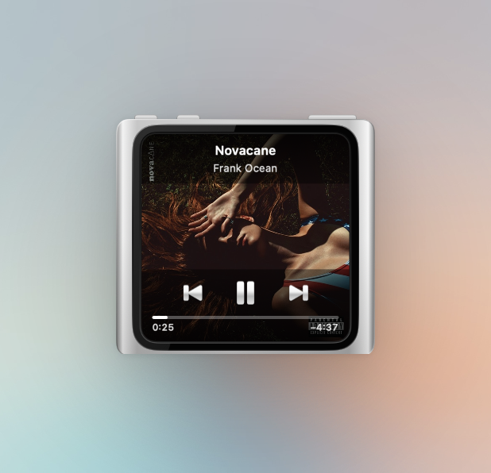

# MacPod

A tiny iPod nano on your Mac that controls whatever's playing.


It looks like a first-generation iPod nano and behaves like one. The clickwheel controls play, pause, and skip, while the screen shows the track, artist, album, artwork, and a blue-striped progress bar. It works with Apple Music, Spotify, YouTube, browsers, podcast apps — basically anything the Mac's system "Now Playing" knows about.

## Features

- **Floating or Window mode** — keep it hovering always-on-top, or place it as a regular window.
- **Remembers its position** — reopens where you left it and stays onscreen when your display setup changes.
- **Two shells** — select the 1st or 6th generation in Settings → Shell. The window resizes in place.
- **Light or dark shell** — it can show either a white or a black iPod, following your system dark mode. 
- **Menu bar icon** — click it for show/hide, transport, settings, quit.
- **Battery indicator** — the little icon in the screen header reflects your actual Mac battery.

## Compact view

Prefer something smaller? Choose **Settings → Shell → iPod nano (6th generation)** for a compact aluminum frame with artwork filling the screen. Hover to reveal the track, artist, silver playback controls, and progress.



The shell comes in silver or graphite through the Color setting and works in both Floating and Window modes. Click the song-title bar or right-click the shell to open Settings.

## Install

1. Download the latest `MacPod.app.zip` from the [releases page](https://github.com/ymolodtsov/macpod/releases/latest).
2. Unzip it and drag **MacPod.app** into your Applications folder.
3. The first time you launch it, macOS will refuse — the app isn't signed by a paid Apple Developer account. To get past Gatekeeper:

   **Option A — right-click open (simplest):**
   - In Finder, **right-click** MacPod.app and choose **Open**.
   - Click **Open** in the warning dialog.
   - You only need to do this once.

   **Option B — remove the quarantine flag in Terminal:**
   ```sh
   xattr -dr com.apple.quarantine /Applications/MacPod.app
   ```
   Then double-click to launch normally.

MacPod lives in your menu bar (the little play/pause icon). Click it for the menu.

## Requirements

- macOS 13 or later (tested up to macOS 26 / Tahoe).

## Building from source

If you'd rather build it yourself:

```sh
git clone https://github.com/ymolodtsov/macpod.git
cd macpod
./Scripts/build-app.sh
open build/MacPod.app
```

Requires Xcode command-line tools. The bundled media-remote adapter is pre-built; to rebuild it from its upstream source, run `./Scripts/rebuild-adapter.sh` (needs `cmake` and `ninja`).

## Credits

Uses the excellent [mediaremote-adapter](https://github.com/ungive/mediaremote-adapter) to talk to macOS's private MediaRemote framework in a way that still works on modern macOS.

## License

MIT.
